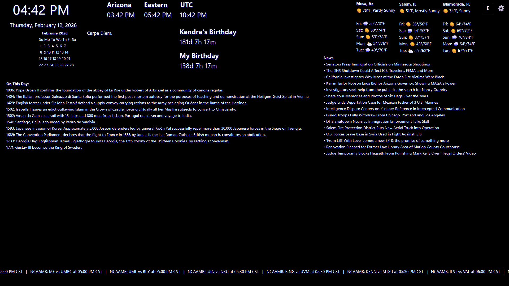

# MagicMirror

MagicMirror is a configurable smart mirror dashboard built with Python and PySide6. It supports live or static backgrounds, draggable overlay widgets, local desktop configuration, and a built-in web manager for remote control on your network.



## Quick Start

```powershell
python -m venv .venv
.\.venv\Scripts\Activate.ps1
python -m pip install -r requirements.txt
python Main.py
```

The application creates `config.json` the first time it saves its settings. A webcam is not required unless camera background mode is selected.

## Current Feature Set

- Background modes:
  - solid color
  - camera input
  - image
  - local video
  - YouTube video
- Display controls:
  - fullscreen mode
  - mirrored video
  - 0 / 90 / 180 / 270 degree rotation
  - fill or fit scaling
  - brightness and blur controls
  - background dimming overlay
- Layout management:
  - drag widgets in edit mode
  - per-widget anchor, size, z-index, lock, and grouping
  - multiple layout pages: `default`, `morning`, `evening`, `work`, `photo-frame`
  - conditional widget visibility rules by time/day/background mode
  - grid snapping
- Configuration workflows:
  - desktop settings panel with live updates
  - web manager with live preview and remote widget editing
  - save/load profiles from `profiles/`
  - save/apply/remove templates from `templates/`
  - theme and readability presets
  - low power mode and optional auto relaunch on crash

## Included Widgets

- `time`
- `date`
- `worldclock`
- `calendar`
- `ical`
- `dailyagenda`
- `commute`
- `weatherforecast`
- `rss`
- `sports`
- `stock`
- `history`
- `countdown`
- `quotes`
- `system`
- `ip`
- `moon`
- `photomemories`
- `flightboard`
- `energyprice`
- `package`
- `sunrisesunset`
- `astronomy`

## Requirements

- Python 3.10+
- Windows is the primary tested environment in this repo
- Webcam is optional and only needed for camera background mode

## Installation

Create and activate a virtual environment, then install the pinned dependencies:

```powershell
python -m venv .venv
.\.venv\Scripts\Activate.ps1
python -m pip install --upgrade pip
python -m pip install -r requirements.txt
```

Notes:

- `yt-dlp` is required for YouTube background playback.
- `psutil` enables the `system` widget.
- The app uses several external APIs depending on which widgets you enable.

## Run

```powershell
python Main.py
```

## Basic Usage

| Action | Control |
| --- | --- |
| Reveal local controls | Move the pointer |
| Open settings | `S` |
| Toggle edit mode | `E` |
| Undo or redo a layout change | `Ctrl+Z` / `Ctrl+Y` |
| Toggle fullscreen | `F11` |
| Exit fullscreen | `Esc` |
| Open the web manager | `http://localhost:815` when enabled |

## Configuration

Primary config is stored in `config.json`.

Supporting folders:

- `profiles/`: saved profile snapshots
- `templates/`: saved widget/layout templates
- `resources/`: icons and images, other related files.

Most settings can be changed from either the desktop UI or the web manager, including:

- background source and playback settings
- widget list and per-widget settings
- page assignment and visibility rules
- fonts, colors, scaling, and presets
- performance and web management options

`config.json`, saved profiles, and user-created templates may contain private URLs, API keys, tracking numbers, or access tokens. Keep these files out of public repositories and backups that are shared with others.

## Widget/API Notes

- `stock` uses Financial Modeling Prep and expects `FMP_API_KEY` in the environment.
- `package` uses AfterShip and needs an API key in widget settings.
- `weatherforecast`, `sunrisesunset`, and `astronomy` rely on network lookups.
- `sports` uses ESPN public scoreboard endpoints.
- `history` uses the MuffinLabs history API.

## Web Manager

The built-in web manager is the recommended way to maintain an installed mirror. It provides:

- live preview
- remote widget dragging
- remote editing of general, appearance, widget, template, and profile settings
- a diagnostics view with widget refresh status

Credentials and private calendar URLs are redacted from browser-visible state. Non-loopback access automatically requires a token, but the server still uses HTTP and is intended for trusted local networks. Do not expose it directly to the public internet.

## Verification

Run the focused regression suite with:

```powershell
python -m unittest discover -s tests -v
```

## Build for Windows

Double-click `Build\BuildMagicMirror.cmd` to build and open the app with the project's existing configuration. The script creates `.venv` when needed and installs the pinned application and build dependencies. Its window stays open so you can read any errors.

To build without launching:

```powershell
.\build_windows.cmd
```

The packaged application is written to `dist\MagicMirror`. Use `.\build_windows.cmd --run` to build and launch from a terminal. Rebuilds preserve configuration, profiles, and templates already in the output folder. Build staging stays under `.cache\pyinstaller`; personal settings are not bundled into the executable.

## Project Structure

| Path | Purpose |
| --- | --- |
| `Main.py` | Desktop application, configuration UI, layouts, and media backgrounds |
| `widget_manager.py` | Widget implementations and refresh management |
| `web_server.py` | Local web manager and remote configuration API |
| `stock_widget.py`, `sports_widget.py`, `history_widget.py` | Specialized widget modules |
| `templates/` | Reusable layout and widget templates |
| `resources/` | Application icons and screenshots |
| `tests/` | Configuration and web security regression tests |
